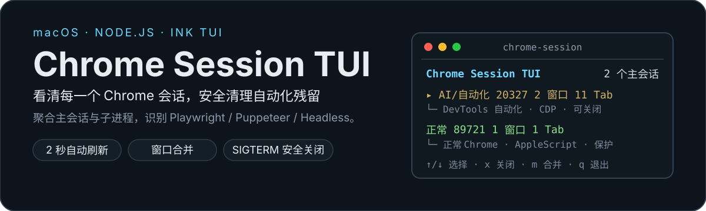
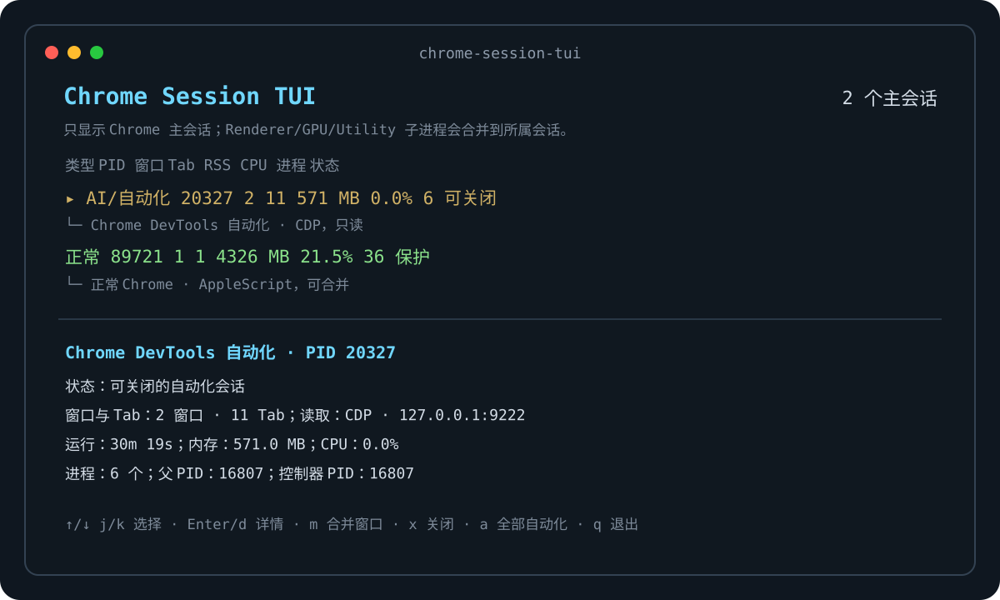

<p align="right"><a href="README.md">中文</a></p>

<p align="center">
  
</p>

<p align="center">
  <a href="https://xiaosang.cc/chrome-session-tui/">▶ Online Intro</a>
  ·
  <a href="https://github.com/holynova/chrome-session-tui">GitHub Repository</a>
</p>

Chrome Session TUI is a macOS terminal tool for inspecting and closing Chrome automation sessions. It aggregates each Chrome main session with its renderer/GPU/utility child processes, identifies Playwright, Puppeteer, headless and remote-debugging instances, and protects normal Chrome from accidental closure. The interactive TUI auto-refreshes every 2 seconds; `list` / `inspect` / `merge` / `close` subcommands are also available.

## Screenshot

<p align="center">
  
</p>

## Features

- **Session aggregation**: only main sessions are listed; renderer/GPU/utility children roll up into their session, with uptime, memory, CPU and process counts.
- **Source detection**: classifies sessions from launch flags and ancestor processes (Playwright, Puppeteer, ChromeDriver, Selenium, chrome-devtools-mcp, headless, remote debugging).
- **Window & tab counts**: read via CDP for automation sessions and via AppleScript for normal Chrome.
- **Safe closing**: SIGTERM by default; `--force` escalates to SIGKILL after a short wait. A controller process shared by multiple sessions is never killed.
- **Window merge**: merge a session's windows into the first window (`m` or `merge <pid>`).
- **Normal Chrome is protected**: neither the `close` command nor the TUI's close action touches the normal browser.

## Keys

| Key | Action |
|---|---|
| ↑ / ↓, j / k | Select a session |
| Enter / d | Expand / collapse details |
| m | Merge the current session's windows |
| x / X | Close the current session (X forces) |
| a / A | Close all automation sessions (A forces) |
| r | Refresh now |
| q / Esc | Quit |

Every close asks for confirmation first: press `y` to confirm, `n` to cancel.

## Usage

Requires macOS and Node.js ≥ 22:

```bash
git clone https://github.com/holynova/chrome-session-tui.git
cd chrome-session-tui
pnpm install
pnpm start          # open the interactive TUI
```

CLI subcommands:

```bash
chrome-session list [--json]   # list current Chrome main sessions
chrome-session inspect <pid>   # details of one session
chrome-session merge <pid>     # merge a session's windows into the first
chrome-session close --all     # close all automation / headless sessions
chrome-session close <pid>     # close one session (--force to force)
```

## Tech

- Ink 7 + React 19 + TypeScript, tsup build, vitest (4 tests).
- Session snapshots come from `ps` process scanning + launch-command analysis; window info comes from CDP (automation sessions) and AppleScript (normal Chrome).

```
src/cli.ts          CLI entry: tui / list / inspect / merge / close
src/ui.tsx          Ink interface: list, details, confirmations, shortcuts
src/processes.ts    Session snapshots, source detection, CDP/AppleScript window reads, close & merge
src/format.ts       Table and duration formatting
src/types.ts        ChromeSession and other type definitions
docs/index.html     Static intro page
docs/screenshot.svg TUI interface diagram
```
